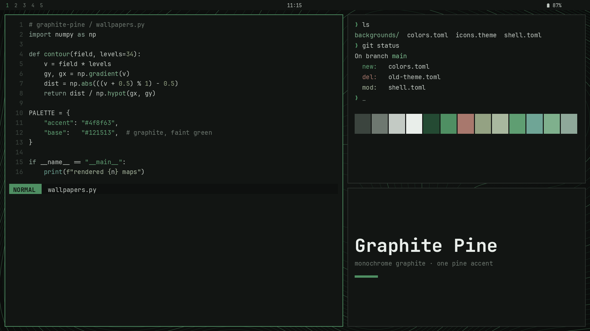
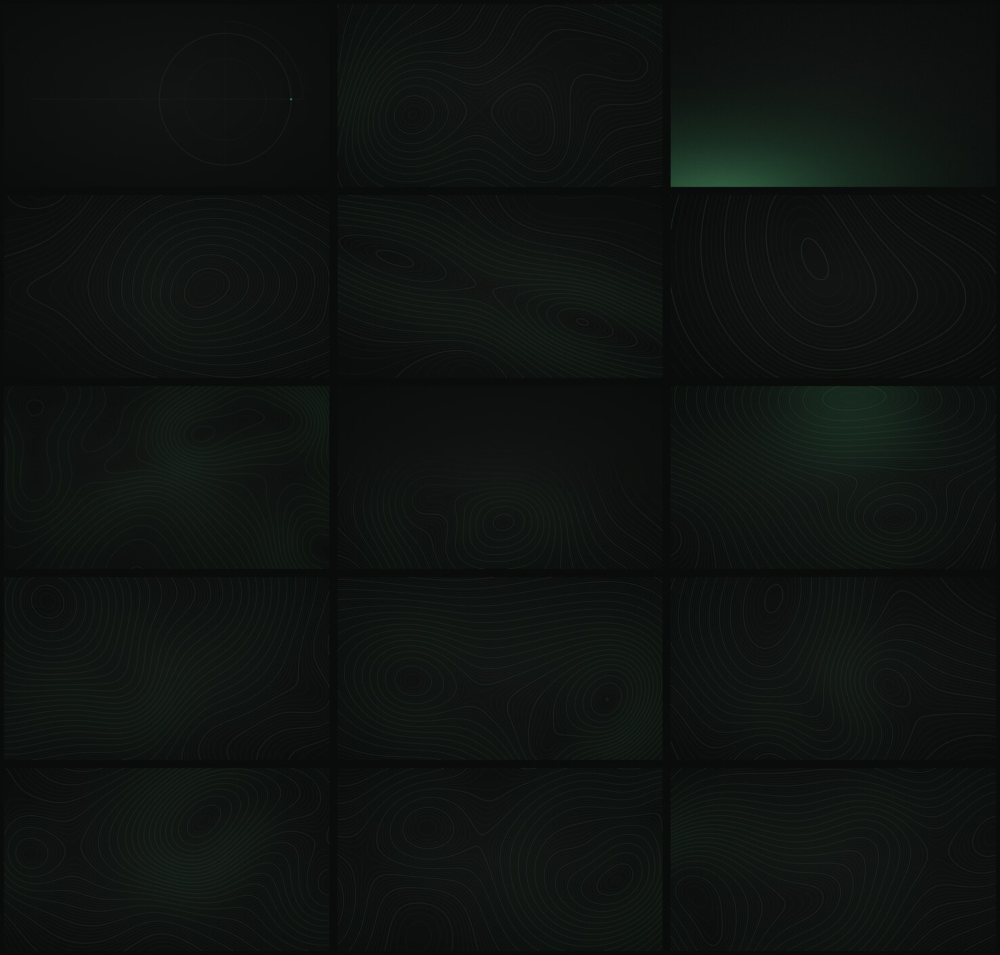
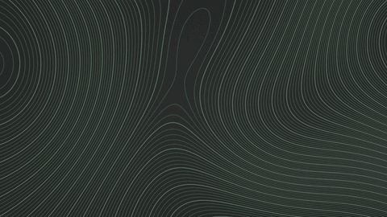

# Graphite Pine

A minimal dark theme for [Omarchy](https://omarchy.org): green-tinted graphite greys
with a single dark pine accent, and topographic wallpapers drawn to match.



## Install

```bash
omarchy theme install https://github.com/samirpokharel/omarchy-graphite-pine-theme
omarchy theme set "Graphite Pine"
```

## Palette

| Role | Color | |
|---|---|---|
| Background | `#121513` | graphite with a faint green cast |
| Foreground | `#c3cac4` | 11:1 contrast on the background |
| Accent | `#4f8f63` | pine: borders, focus, selection, lock screen |
| Border gradient | `#4f8f63` → `#244a33` | active window, 45° |
| Muted | `#3b443e` | comments, line numbers, inactive chrome |

The 16 terminal colors stay inside the same family (sage, lichen, moss, pine) so the
terminal reads like the wallpaper. Red keeps a faint clay warmth so errors still stand
out. Every terminal color is at least 4.9:1 against the background.

Everything else (terminals, btop, Neovim, VS Code, Hyprland, the Omarchy shell) is
generated by Omarchy from `colors.toml`. `shell.toml` is hand-tuned on top: pine marks
focus, selected rows and the lock-screen field; hover stays neutral grey.

## Wallpapers

Fifteen 4K wallpapers, all rendered from code. Cycle them with `omarchy theme bg next`.



| # | Name | |
|---|---|---|
| 1 | geometric | rings, dot grid and a single accent square |
| 2 | topographic | the original contour map |
| 3 | grain | pine glow rising from the lower left, with film grain |
| 4–9 | summit, ridgeline, sparse, dense, valley, glow | themed contour variants |
| 10–15 | topo-404 … topo-909 | same recipe as #2, different terrain |

### Live wallpaper



`backgrounds/topo-live.mp4` is a 30-second seamless loop (1920×1080, 30 fps): the
contour lines flow outward while the terrain slowly breathes. It needs the
[live-wallpaper](https://github.com/yesheytenzin/live-wallpaper) shell plugin:

```bash
omarchy plugin add https://github.com/yesheytenzin/live-wallpaper.git --enable
```

Then pick it from **Style → Background** (or double-click the desktop). Without the
plugin Omarchy simply ignores the video.

## Regenerating the art

The scripts in `scripts/` produce every image and the video. They need Python 3 with
NumPy and Pillow; the video also needs `ffmpeg`.

```bash
python3 scripts/base-wallpapers.py backgrounds/                         # 1-3
python3 scripts/topo-variants.py backgrounds/                           # 4-9
python3 scripts/topo-siblings.py backgrounds/ 404 606 707 202 303 909   # 10-15 (as seed-N.jpg)
python3 scripts/live-wallpaper.py backgrounds/topo-live.mp4             # ~8 min on 8 cores
python3 scripts/preview.py .                                            # preview.png
```

How the contours work: each map is a height field made of summed Gaussian hills. A
line is drawn where the height crosses a level, and each pixel's distance to that
line is divided by the local gradient, which keeps every line about 1 px wide on
steep and flat ground alike. The video stays seamless because both motions are
periodic: the hills orbit full circles, and the levels shift by exactly 5 steps per
loop, which is the spacing of the brighter accent lines.

## License

MIT. See [LICENSE](LICENSE).
